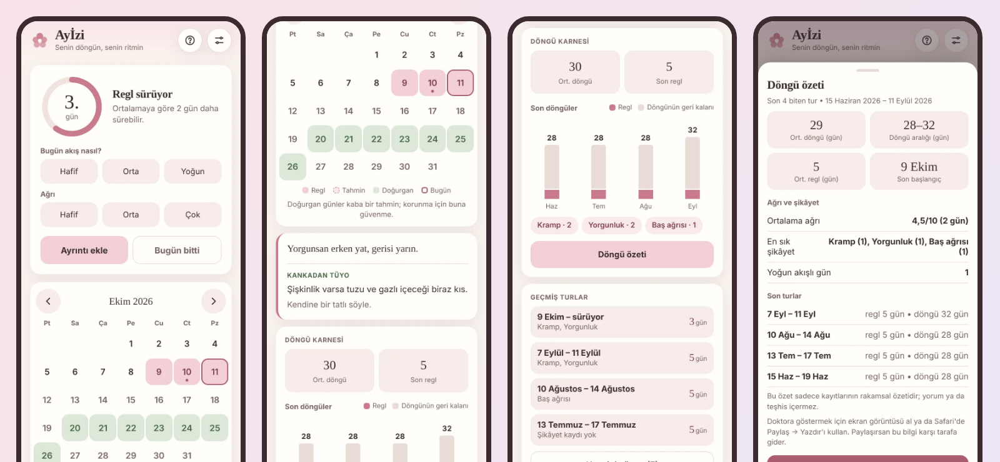

# Ayİzi: a private cycle tracker (case study)

**A small web app for one person: log a period day in one tap, see estimates in a calendar, get quiet reminders by email. It runs on Google Apps Script and keeps the data in one Google account.**

**Read the full case study:** https://mkemalkahraman.github.io/ayizi-case-study/

## At a glance

- Web app that opens from the phone home screen, built for a single user
- Google Apps Script (server and page in one project), Google Sheets as the database, Gmail for reminders
- PIN sign-in; the PIN stays on the server and a 90-day session key is stored only as a digest
- Reminders are private by default: a lock screen shows "Ayİzi" and one short line
- 75 automated tests that run in Node against fakes of the Google services
- 18 versions, 3.0.0 to 3.7.1, between 11 and 28 October 2026
- The server code makes no call to any outside service

## What it does

- **Today:** flow and pain are logged with one tap on the main card
- **Calendar:** logged days, estimated days and estimated fertile days, each with a plain label and a margin
- **Report card:** average cycle, last period length and one chart with the values written on it
- **Cycle summary:** one sheet of numbers for an appointment, with no interpretation and a sharing warning
- **Reminders:** email through Gmail, with details hidden unless switched on
- **Privacy:** no health data in logs, nothing stored on the phone except the session key

## Lessons from real bugs

- **A half-pasted file poured code onto the screen:** the page file now ends with a marker and a version, and a health check reports a half file. [Read more](https://mkemalkahraman.github.io/ayizi-case-study/#lesson-paste)
- **A flower became question marks:** emoji in a Gmail subject broke in another mail program, so they are stripped and written as numeric codes. [Read more](https://mkemalkahraman.github.io/ayizi-case-study/#lesson-emoji)
- **A footer that blamed the wrong file:** a cache kept a package from the previous version, so the version is now part of the cache key. [Read more](https://mkemalkahraman.github.io/ayizi-case-study/#lesson-cache)
- **"A bit slow" could not be measured from outside:** the settings sheet now shows open time, server time and data source. [Read more](https://mkemalkahraman.github.io/ayizi-case-study/#lesson-slow)

All four are on the [Lessons from real bugs](https://mkemalkahraman.github.io/ayizi-case-study/#lessons) section of the case study page.

## About this repository

- **No source code is published here.** This is a case study only.
- **All screenshots use invented data.** The dates and entries are made up for this page, and the app itself holds private health data and is not public.
- The app's interface is in Turkish because it was built for a Turkish speaker. The labels are explained next to each screen.
- The page contains no medical advice.

## Credit

Built with Claude as a pair programmer. Product decisions, the rules and testing on a real phone are mine.
